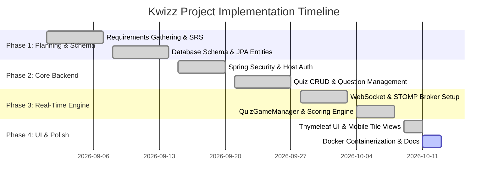

# Project Proposal: Kwizz (Real-Time Interactive Quiz Platform)

**Course / Module:** Advanced Java Project  
**Author / Developer:** Karmveer  
**Technology Stack:** Java 21, Spring Boot 3.3.4, Spring WebSocket (STOMP), Spring Data JPA, PostgreSQL, Thymeleaf, Google ZXing, Docker  
**Date:** October 2026  
**Status:** Approved / Implemented  

---

## 1. Executive Summary

In contemporary educational and corporate settings, active participation and knowledge retention are significantly enhanced through gamification and real-time interaction. Existing commercial platforms (such as Kahoot, Quizizz, and Mentimeter) impose stringent paywalls, participant limits, subscription fees, and heavy third-party vendor lock-in.

**Kwizz** is an open-source, full-stack, real-time multiplayer quiz application designed to deliver low-latency classroom engagement without commercial constraints. Built on modern Java 21 and Spring Boot 3.3.4, Kwizz enables quiz hosts (educators, instructors, organizers) to create custom quizzes, initiate live sessions with automatically generated 6-character room codes and QR codes, broadcast questions synchronously over WebSockets, evaluate answers instantaneously with a dynamic time-decay scoring algorithm, and stream live interactive leaderboards to all connected participants.

---

## 2. Problem Statement

1. **High Commercial Costs & Paywalls:** Commercial interactive polling platforms restrict audience size (often capping free tiers at 10–20 players) and lock core features like detailed leaderboards and custom question timers behind recurring monthly subscriptions.
2. **High Latency in Polling-Based Solutions:** Naive web applications rely on repetitive HTTP polling (`setInterval`), leading to unnecessary network saturation, high database overhead, and out-of-sync questions across devices.
3. **Friction in Participant Onboarding:** Traditional platforms frequently require participants to download proprietary mobile apps or register permanent accounts, causing significant classroom disruption and onboarding delays.
4. **Data Ownership & Privacy Concerns:** Educational institutions often handle student metadata that should not be transmitted to commercial ad-supported cloud vendors.

---

## 3. Proposed Solution

Kwizz addresses these challenges by offering a self-hosted, lightweight, high-performance web platform with the following core pillars:

- **Instant Zero-Install Access:** Participants enter a 6-character room code or scan an on-screen QR code (generated dynamically via Google ZXing) on any browser-enabled mobile phone, tablet, or laptop. No login or password is required for players; session continuity is preserved via ephemeral UUID tokens.
- **Bi-Directional Real-Time Synchronization:** Leveraging Spring WebSocket and the STOMP sub-protocol over SockJS, all session state transitions (lobby joiners, countdown start, question push, timer synchronization, leaderboard reveal) are broadcasted to hundreds of clients in sub-second latency.
- **Host Control & Security:** Host accounts are guarded by Spring Security 6 with BCrypt password hashing. Hosts maintain granular CRUD control over their quizzes and questions, with strict ownership checks preventing unauthorized access.
- **Competitive Time-Decay Scoring:** Points reward both correctness and rapid response time:
  $$\text{Points} = 100 + \left\lfloor \frac{\max(0, \text{TimeLimit} - \text{AnswerTime})}{100} \right\rfloor$$
- **Enterprise Ready & Containerized:** Packaged with a multi-stage Docker build running on Eclipse Temurin 21 JRE, enabling single-command containerized deployment alongside PostgreSQL.

---

## 4. Objectives & Project Scope

### 4.1 Key Objectives
1. Build an end-to-end multi-tier web application using modern Spring Boot 3.3.4 and Java 21 LTS.
2. Implement robust bi-directional pub/sub messaging using WebSockets with fallback support (SockJS).
3. Deliver a responsive, mobile-first user interface with zero-dependency CSS, automatic system dark/light theme detection, and tactile option selection.
4. Ensure transactional integrity across relational entities using Spring Data JPA and Hibernate with PostgreSQL.
5. Provide comprehensive documentation including SRS, UML diagrams, architecture guides, and deployment workflows.

### 4.2 In-Scope Features
- Host authentication (registration, BCrypt credential hashing, secure login/logout).
- Quiz authoring (Title, description, multi-choice questions with customized time limits from 5 to 120 seconds).
- Session orchestration (Lobby state, real-time participant roster updates, QR code generation, step-by-step question progression, auto-timeout detection, host-controlled leaderboard reveal).
- Real-time player interface (Live timers, colored response tiles A/B/C/D, instant submission lock, immediate visual feedback).
- Live leaderboard calculations (Ordered score aggregation across completed questions).
- Containerized packaging via Docker.

### 4.3 Out-of-Scope (Future Scope)
- Sound effects and background audio synthesis.
- Team-based multiplayer matchmaking.
- Rich media questions (audio clips, embedded video).
- Multi-host team collaboration on a single quiz draft.

---

## 5. Technology Stack & Architectural Justification

| Layer / Concern | Technology | Justification |
| :--- | :--- | :--- |
| **Language** | **Java 21 LTS** | LTS stability, virtual threads compatibility, enhanced pattern matching, record types, and modern garbage collection. |
| **Backend Framework** | **Spring Boot 3.3.4** | Production-ready convention-over-configuration framework with embedded Tomcat 10, integrated security, and Spring Data. |
| **Real-Time Protocol** | **Spring WebSocket + STOMP / SockJS** | Standardized publish-subscribe message routing (`/topic` destinations) with graceful SockJS fallback over HTTP long-polling for restrictive networks. |
| **Database & ORM** | **PostgreSQL + Hibernate / JPA** | ACID compliance, strong relational integrity, foreign key cascading, and performance under concurrent read/write loads. |
| **Security** | **Spring Security 6** | Industry-standard authentication filter chains, BCrypt hashing, session hijacking protection, and role separation. |
| **Template Engine** | **Thymeleaf + SpringSecurity6 Extras** | Server-side rendering without JavaScript framework bloat, fast initial page loads, and natural HTML templating. |
| **Utilities** | **Google ZXing 3.5.3** | High-speed server-side matrix encoding for generating on-the-fly QR code PNG streams for seamless mobile joins. |
| **Frontend Styling** | **Modern CSS + Vanilla JS** | Pure CSS design tokens, dynamic dark/light theme switcher, responsive grid, and zero client-side build-step overhead. |
| **DevOps & Containers**| **Docker & Docker Compose** | Multi-stage build (`maven:3.9.6-eclipse-temurin-21` & `eclipse-temurin:21-jre-jammy`) for lean, secure container images. |

---

## 6. Project Timeline & Milestones

---

## 7. Deliverables

1. **Complete Source Code Repository:** Fully functional Spring Boot 3.3.4 project with clean multi-tier architecture.
2. **Software Requirements Specification (SRS):** IEEE 830 compliant functional and non-functional requirements documentation.
3. **Formal UML Diagrams Suite:** Class, Sequence, State Machine, Use Case, Activity, and ER diagrams.
4. **Comprehensive Academic Project Report:** Detailed theoretical basis, implementation analysis, database design, testing protocols, and future horizons.
5. **Container Artifacts:** Production-ready `Dockerfile` and setup instructions.
