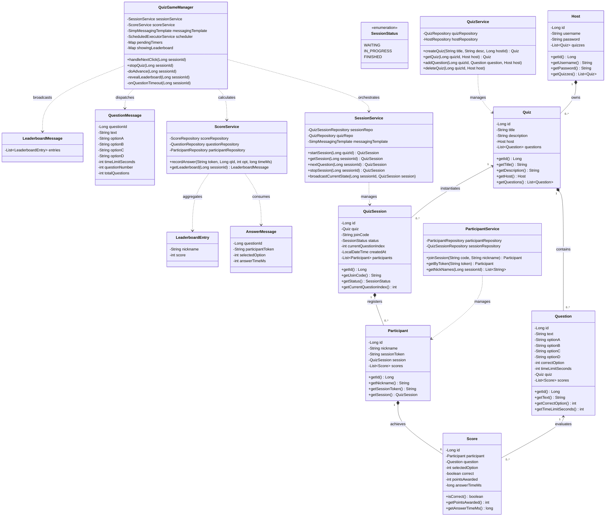
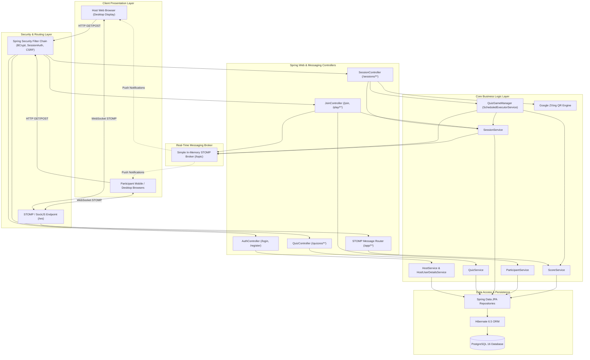
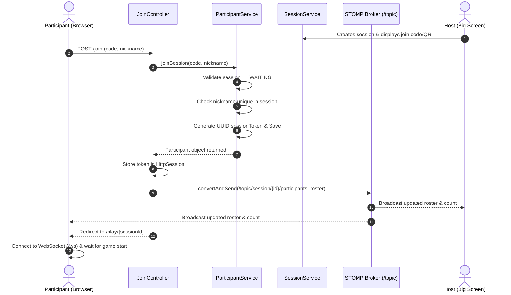
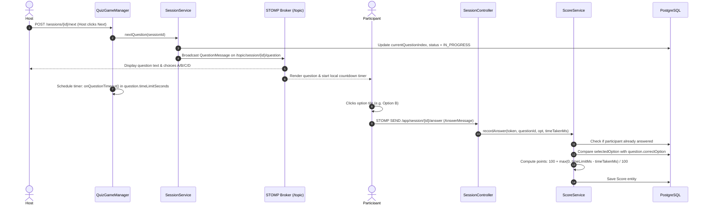
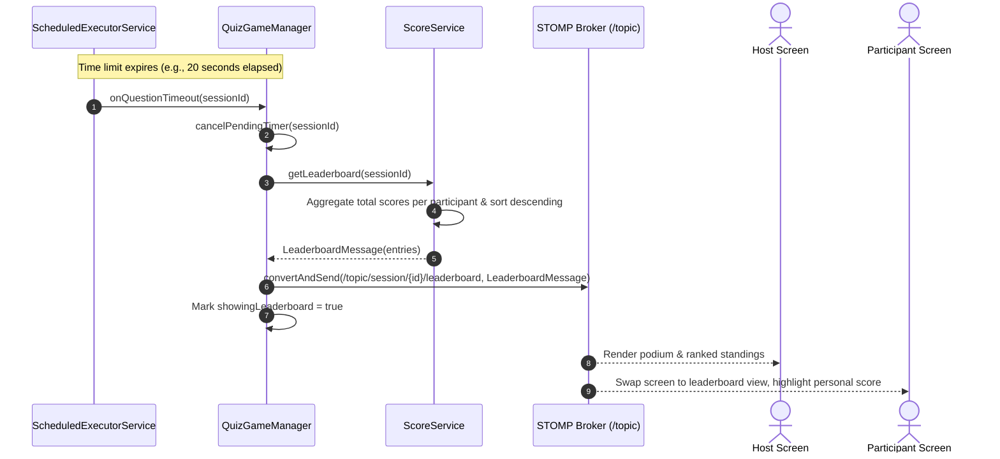
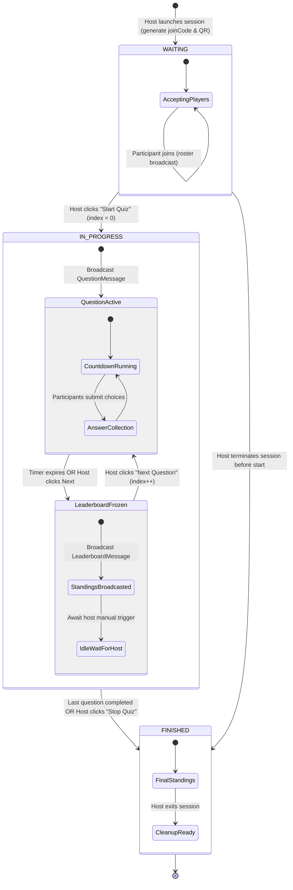
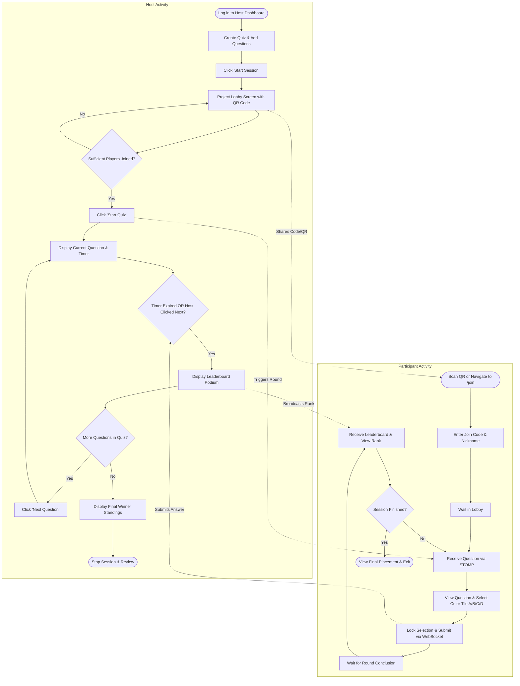
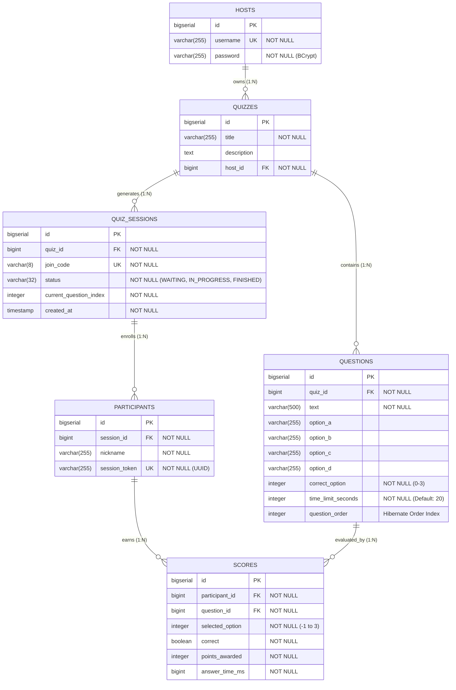

# Unified Modeling Language (UML) Specification
## Project: Kwizz — Real-Time Interactive Quiz System

This document contains the complete visual and structural architecture models for the **Kwizz** platform, specified using standard UML notation rendered via Mermaid.

---

## Table of Contents
1. [Use Case Diagram](#1-use-case-diagram)
2. [Domain Class Diagram](#2-domain-class-diagram)
3. [Component & Architecture Diagram](#3-component--architecture-diagram)
4. [Sequence Diagrams](#4-sequence-diagrams)
   - 4.1 Participant Join & Lobby Synchronization
   - 4.2 Question Dispatch, Answer Submission & Scoring
   - 4.3 Automated Timeout & Leaderboard Reveal
5. [State Machine Diagram (Session Lifecycle)](#5-state-machine-diagram-session-lifecycle)
6. [Activity Diagram (Gameplay Loop)](#6-activity-diagram-gameplay-loop)
7. [Entity-Relationship (ER) Diagram](#7-entity-relationship-er-diagram)
8. [Deployment Diagram (Docker Architecture)](#8-deployment-diagram-docker-architecture)

---

## 1. Use Case Diagram

The Use Case model defines the functional interactions between primary actors (**Quiz Host**, **Participant**, and **System Timer**) and the application.

```mermaid
flowchart LR
    subgraph Actors
        Host["Host (Educator)"]
        Participant["Participant (Student)"]
        Timer["System Scheduler (Timer)"]
    end

    subgraph "Kwizz System Boundary"
        UC1(["Register & Authenticate"])
        UC2(["Create / Edit / Delete Quiz"])
        UC3(["Add / Remove Questions"])
        UC4(["Launch Live Session"])
        UC5(["Display QR Code & Join Code"])
        UC6(["Join Session (Nickname & Code)"])
        UC7(["Broadcast Roster Over WebSocket"])
        UC8(["Advance Question / Start Quiz"])
        UC9(["Synchronize Real-time Countdown"])
        UC10(["Submit Answer Option"])
        UC11(["Compute Score & Time Bonus"])
        UC12(["Broadcast Leaderboard"])
        UC13(["Auto-trigger Timeout Reveal"])
        UC14(["Stop / Finish Session"])
    end

    Host --> UC1
    Host --> UC2
    Host --> UC3
    Host --> UC4
    Host --> UC5
    Host --> UC8
    Host --> UC14

    Participant --> UC6
    Participant --> UC10

    Timer --> UC13
    Timer --> UC9

    UC4 ..> UC5 : <<include>>
    UC6 ..> UC7 : <<include>>
    UC8 ..> UC9 : <<include>>
    UC10 ..> UC11 : <<include>>
    UC13 ..> UC12 : <<include>>
    UC8 ..> UC12 : <<include>>
```

---

## 2. Domain Class Diagram

This diagram captures the core entities, business services, controllers, data transfer objects, and their relationships within the Spring Boot application.



---

## 3. Component & Architecture Diagram

This diagram displays the multi-tier logical architecture of Kwizz, highlighting Spring Security, Web MVC, the In-Memory STOMP Broker, Services, and Data Access.



---

## 4. Sequence Diagrams

### 4.1 Participant Join & Lobby Synchronization
Illustrates a participant joining an active session via room code/QR and the real-time notification pushed to the host display.



---

### 4.2 Question Dispatch, Answer Submission & Scoring
Shows the host advancing to a question, the server broadcasting the question without the answer key, participants submitting answers, and real-time point calculation.



---

### 4.3 Automated Timeout & Leaderboard Reveal
Details the countdown timer expiration handling, asynchronous cancellation, and leaderboard broadcasting.



---

## 5. State Machine Diagram (Session Lifecycle)

Models the discrete operational states of a `QuizSession` throughout its execution.



---

## 6. Activity Diagram (Gameplay Loop)

Tracks the operational workflows of the Host and Participant swimming lanes in parallel.



---

## 7. Entity-Relationship (ER) Diagram

Defines the exact PostgreSQL physical database schema, tables, column types, and relational foreign-key cardinalities.



---

## 8. Deployment Diagram (Docker Architecture)

Illustrates the physical deployment node topology inside a Dockerized container environment.

```mermaid
flowchart TB
    subgraph ClientNodes ["Client Devices"]
        Desktop["Teacher Workstation (Host Display)<br/>Modern Web Browser"]
        Mobiles["Student Smartphones / Laptops (Participants)<br/>Mobile Browsers (iOS / Android / Chrome)"]
    end

    subgraph DockerHost ["Docker Container Host (Linux / Cloud VM)"]
        subgraph BridgeNet ["Docker Bridge Network: kwizz-network"]
            subgraph AppContainer ["Docker Container: kwizz-app"]
                direction TB
                Tomcat["Embedded Apache Tomcat 10<br/>Port: 8080"]
                JRE["Eclipse Temurin OpenJDK 21 JRE"]
                SpringApp["Kwizz Spring Boot Application (kwizz-0.0.1-SNAPSHOT.jar)"]
                Tomcat --- SpringApp
                JRE --- SpringApp
            end

            subgraph DBContainer ["Docker Container: kwizz-db"]
                PostgresEngine["PostgreSQL 16 Engine<br/>Port: 5432"]
                PGData[("Named Volume: pgdata<br/>/var/lib/postgresql/data")]
                PostgresEngine --- PGData
            end
        end
    end

    Desktop -->|HTTP:8080 / WS:8080| Tomcat
    Mobiles -->|HTTP:8080 / WS:8080| Tomcat
    SpringApp -->|JDBC:5432 (Internal Network)| PostgresEngine
```
